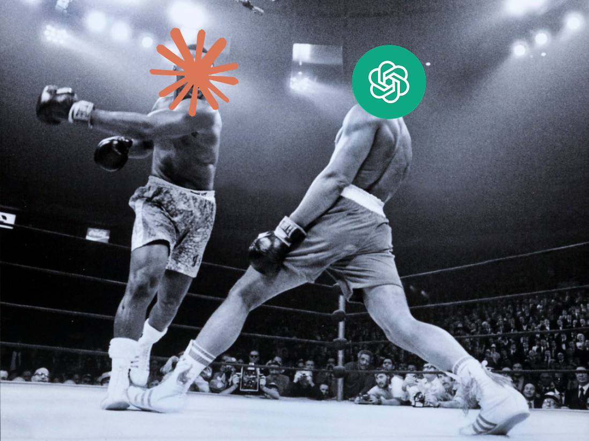
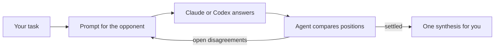

<div align="center">

# Sparring

**A Claude Code skill that gets your AI agent a second opinion from another model and argues it out before answering you.**

[](https://github.com/nyxandro/sparring-skill/releases)
[](LICENSE)
[](https://agentskills.io/specification)
[](#install)

**English** · [Русский](README.ru.md)



</div>

Sparring is a model-vs-model skill for Claude Code, Codex, OpenCode, Cursor and other agents that
can run shell commands. Ask your agent to spar with Claude or Codex, and it sends the task to the
other CLI agent, reads its independent answer, pushes back on the weak points over a few turns and
brings you one synthesis instead of a raw transcript.

## Why

A single model tends to agree with itself, and with you. It picks the first framing that looks
reasonable and rarely questions it. A second model that is told to challenge the task finds a
different set of holes. Sparring is useful when one answer isn't enough.

- Brainstorming an idea before you build it.
- A second opinion on an architecture or a plan.
- A review of code or a risky change.
- Comparing alternatives.
- Stress-testing your own conclusion.

## Install

| Agent | Command |
|---|---|
| Claude Code, as a plugin | `/plugin install sparring --marketplace nyxandro/skills` |
| Claude Code, Codex, OpenCode, Cursor and others | `npx skills add nyxandro/sparring-skill` |
| Any agent, by hand | Download the [latest `.skill` archive](https://github.com/nyxandro/sparring-skill/releases/latest/download/sparring.skill) and unpack it into the agent's skills folder |

Pick one. If you install it two ways, Claude Code loads the skill twice.

<details>
<summary>Requirements and more install options</summary>

<br>

- Linux with Bash 4 or newer and GNU `timeout`.
- The opponent CLI installed and signed in, `claude` for Claude and `codex` for Codex.
- `tmux`, only if you want a live session you can watch.
- The one-line plugin install needs Claude Code 2.1.275 or later. On an older version, add the
  catalog first with `/plugin marketplace add nyxandro/skills` and then run
  `/plugin install sparring@nyxandro`.
- With `npx skills`, add `-g` to install the skill for every project. To install a given version,
  add its tag, as in `nyxandro/sparring-skill@v1.0.0`.
- To install from the archive by hand, unzip it into the skills folder, for example
  `unzip sparring.skill -d ~/.claude/skills` or `unzip sparring.skill -d ~/.config/opencode/skills`.
  The archive already holds the `sparctl` harness, so nothing else needs to be checked out.

</details>

## Usage

Ask in plain words. These requests all start the skill.

- *Do sparring with Claude on this plan.*
- *Run a sparring review of this change with Codex.*
- *Get a second opinion through sparring on the database choice.*
- *Discuss this architecture with Codex and tell me where you disagree.*

The skill answers in the language you wrote in and asks the opponent to answer in it too.

## How it works



1. The agent picks the opponent from your words and checks that its CLI is installed. If you name
   only a model family, it asks which CLI should play it instead of guessing.
2. It sends the task with a sparring protocol. The opponent restates the task, checks the framing
   and whether the tools are current, lists the disputed points, and only then answers.
3. The opponent is told to resist the usual habit of agreeing with the user or the other agent.
4. The agent compares the answer with its own position. While a disagreement still matters, it
   sends a focused follow-up in the same session.
5. It stops when the key decisions are settled or the remaining disagreements are written down as
   trade-offs, then deletes the temporary files.

Calls run in non-interactive mode, `claude -p` and `codex exec`, and resume the same provider
session on every turn. A tmux mode exists for agents that only offer an interactive interface, or
when you want to watch the other agent live.

## What you get back

A synthesis, not a transcript. It opens with the recommendation, then covers the task as both
sides understood it, the framing checks, what the models agreed on, what was disputed, which
decisions changed, the alternatives compared, the trade-offs left open and the next steps. If the
sparring stopped because data was missing, you get a short table of questions, why each one
matters and which decision it blocks.

## Versions

The current version sits in `metadata.version` of `sparring/SKILL.md`, so any installed copy tells
you which one it is. Every version has a git tag and a
[release](https://github.com/nyxandro/sparring-skill/releases) with its own archive.
[CHANGELOG.md](CHANGELOG.md) lists what changed.

<details>
<summary>Harness commands</summary>

<br>

Most people never run these, the skill does it for you.

```bash
# Multi-turn sparring with the provider's own session state.
sparring/bin/sparctl ask-session claude /tmp/sparring.log "First question" /tmp/turn-1.txt
sparring/bin/sparctl ask-session claude /tmp/sparring.log "Follow-up" /tmp/turn-2.txt
sparring/bin/sparctl ask-session codex /tmp/codex-sparring.log "First question" /tmp/codex-turn.txt

# A live tmux session, only when you want to watch it.
sparring/bin/sparctl start claude
tmux attach -t spar-claude
sparring/bin/sparctl stop claude
```

Run the test suite with `bash test/run-all.sh`.

</details>

<details>
<summary>Known limits</summary>

<br>

- Non-interactive mode is the reliable path. Tmux mode is there for interactive interfaces only.
- In tmux mode a prompt is sent as one line, so multi-line prompts are flattened first.
- Tmux mode decides an answer is complete when the screen stops changing. A very long pause inside
  an answer can confuse it, so use the transcript export for long answers.

</details>

<details>
<summary>Repository layout</summary>

<br>

```text
sparring/                   the skill
  SKILL.md                  instructions for the agent
  bin/sparctl               the non-interactive CLI and tmux controls
  lib/print-agent.sh        claude -p and codex exec providers with session state
  lib/tmux-agent.sh         the live tmux fallback
dist/sparring.skill         the skill folder as a downloadable archive
test/                       smoke and regression tests
CHANGELOG.md                what changed in each version
README.md, README.ru.md     this page in English and in Russian
```

</details>

## License

[MIT](LICENSE)
