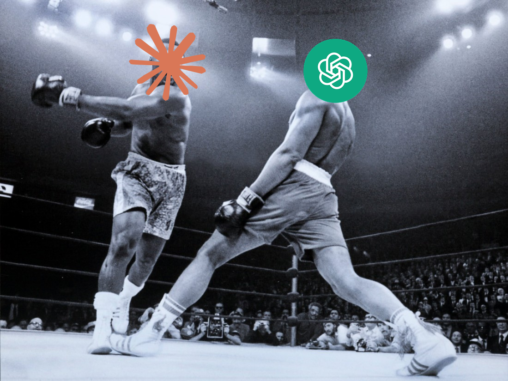
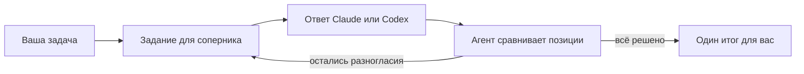

<div align="center">

# Sparring

**Скилл для Claude Code, который берёт второе мнение у другой модели и спорит с ней, прежде чем ответить вам.**

[](https://github.com/nyxandro/sparring-skill/releases)
[](LICENSE)
[](https://agentskills.io/specification)
[](#установка)

[English](README.md) · **Русский**



</div>

Sparring это спарринг модели с моделью для Claude Code, Codex, OpenCode, Cursor и других агентов,
которые умеют запускать команды в терминале. Попросите агента устроить спарринг с Claude или
Codex. Он отправит задачу другому CLI-агенту, прочитает его независимый ответ, за несколько ходов
надавит на слабые места и принесёт вам один итог, а не сырую переписку.

## Зачем

Одна модель склонна соглашаться с собой и с вами. Она берёт первую разумную постановку задачи и
редко её оспаривает. Вторая модель, которой велено спорить, находит другие дыры. Спарринг полезен,
когда одного ответа мало.

- Обсудить идею до того, как её строить.
- Получить второе мнение об архитектуре или плане.
- Проверить код или рискованную правку.
- Сравнить варианты.
- Проверить на прочность собственный вывод.

## Установка

| Агент | Команда |
|---|---|
| Claude Code, как плагин | `/plugin install sparring --marketplace nyxandro/skills` |
| Claude Code, Codex, OpenCode, Cursor и другие | `npx skills add nyxandro/sparring-skill` |
| Любой агент, вручную | Скачайте [архив `.skill` последнего выпуска](https://github.com/nyxandro/sparring-skill/releases/latest/download/sparring.skill) и распакуйте в папку скиллов агента |

Выберите один способ. Если поставить двумя, Claude Code загрузит скилл дважды.

<details>
<summary>Требования и другие способы установки</summary>

<br>

- Linux с Bash 4 или новее и GNU `timeout`.
- Установленный и авторизованный CLI соперника, `claude` для Claude и `codex` для Codex.
- `tmux`, только если хотите живую сессию, за которой можно наблюдать.
- Установка плагина одной командой работает в Claude Code 2.1.275 и новее. На старой версии
  сначала добавьте каталог командой `/plugin marketplace add nyxandro/skills`, потом выполните
  `/plugin install sparring@nyxandro`.
- С `npx skills` добавьте `-g`, чтобы скилл стоял во всех проектах. Чтобы поставить определённую
  версию, допишите её метку, например `nyxandro/sparring-skill@v1.0.0`.
- Чтобы поставить из архива вручную, распакуйте его в папку скиллов, например
  `unzip sparring.skill -d ~/.claude/skills` или `unzip sparring.skill -d ~/.config/opencode/skills`.
  Обвязка `sparctl` уже внутри архива, больше ничего скачивать не нужно.

</details>

## Как пользоваться

Просите обычными словами. На такие запросы скилл запускается.

- *Устрой спарринг с Claude по этому плану.*
- *Проведи спарринг-ревью этой правки с Codex.*
- *Возьми второе мнение через спарринг по выбору базы данных.*
- *Обсуди эту архитектуру с Codex и скажи, в чём вы не согласны.*

Скилл отвечает на языке вашего запроса и просит соперника отвечать на нём же.

## Как работает



1. Агент выбирает соперника по вашим словам и проверяет, что его CLI установлен. Если вы назвали
   только семейство моделей, он спросит, какой CLI будет за него играть, а не будет угадывать.
2. Отправляет задачу вместе с протоколом спарринга. Соперник пересказывает задачу, проверяет
   постановку и актуальность инструментов, перечисляет спорные места и только потом отвечает.
3. Сопернику прямо сказано не поддаваться привычке соглашаться с пользователем или другим агентом.
4. Агент сравнивает ответ со своей позицией. Пока разногласие важно, он отправляет прицельный
   следующий ход в той же сессии.
5. Останавливается, когда ключевые решения приняты или оставшиеся разногласия записаны как
   компромиссы, и удаляет временные файлы.

Вызовы идут в неинтерактивном режиме, через `claude -p` и `codex exec`, и на каждом ходу
продолжают ту же сессию провайдера. Режим tmux нужен для агентов, у которых есть только
интерактивный интерфейс, или когда хочется смотреть на другого агента вживую.

## Что вы получите

Итог, а не переписку. Сначала рекомендация, потом задача, как её поняли обе стороны, проверка
постановки, в чём модели сошлись, о чём спорили, какие решения поменялись, какие варианты
сравнили, какие компромиссы остались и что делать дальше. Если спарринг остановился из-за нехватки
данных, вы получите короткую таблицу вопросов. В ней сказано, зачем нужен каждый вопрос и какое решение он
блокирует.

## Версии

Текущая версия записана в поле `metadata.version` файла `sparring/SKILL.md`, так что любая
установленная копия показывает, какая она. У каждой версии есть метка в git и
[выпуск](https://github.com/nyxandro/sparring-skill/releases) со своим архивом.
[CHANGELOG.md](CHANGELOG.md) рассказывает, что изменилось.

<details>
<summary>Команды обвязки</summary>

<br>

Обычно их никто не запускает руками, скилл делает это сам.

```bash
# Спарринг в несколько ходов с собственной сессией провайдера.
sparring/bin/sparctl ask-session claude /tmp/sparring.log "First question" /tmp/turn-1.txt
sparring/bin/sparctl ask-session claude /tmp/sparring.log "Follow-up" /tmp/turn-2.txt
sparring/bin/sparctl ask-session codex /tmp/codex-sparring.log "First question" /tmp/codex-turn.txt

# Живая сессия в tmux, только если хотите за ней наблюдать.
sparring/bin/sparctl start claude
tmux attach -t spar-claude
sparring/bin/sparctl stop claude
```

Тесты запускаются командой `bash test/run-all.sh`.

</details>

<details>
<summary>Ограничения</summary>

<br>

- Надёжный путь это неинтерактивный режим. Режим tmux нужен только для интерактивных интерфейсов.
- В режиме tmux задание отправляется одной строкой, поэтому многострочный текст сначала
  склеивается.
- Режим tmux считает ответ законченным, когда экран перестаёт меняться. Очень долгая пауза внутри
  ответа может его сбить, поэтому для длинных ответов используйте выгрузку переписки.

</details>

<details>
<summary>Устройство репозитория</summary>

<br>

```text
sparring/                   сам скилл
  SKILL.md                  инструкции для агента
  bin/sparctl               неинтерактивный CLI и управление tmux
  lib/print-agent.sh        провайдеры claude -p и codex exec с состоянием сессии
  lib/tmux-agent.sh         запасной режим через живой tmux
dist/sparring.skill         папка скилла архивом для скачивания
test/                       дымовые и регрессионные тесты
CHANGELOG.md                что изменилось в каждой версии
README.md, README.ru.md     эта страница на английском и на русском
```

</details>

## Лицензия

[MIT](LICENSE)
